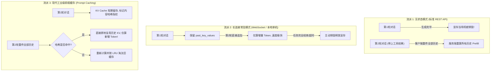

# 深度专题：KV Cache（键值缓存）核心机制、工程部署与工业级避坑指南

> **导读**：在 Transformer 架构中，KV Cache 是推理加速的绝对核心，但它也是工业级线上服务（多用户高并发、长程 Agent）中最主要的**显存吞噬者**与**性能瓶颈**。本文整理了关于 KV Cache 最容易困惑的 4 大灵魂拷问。

---

## 目录
1. [一、KV Cache 到底保存在哪？多用户调用时如何存储？](#一kv-cache-到底保存在哪多用户调用时如何存储)
2. [二、什么时候销毁？长程任务与 Agent 多轮会话中它是怎么工作的？](#二什么时候销毁长程任务与-agent-多轮会话中它是怎么工作的)
3. [三、为什么项目源码里的裸 `torch.cat` 只能单机/单人玩？](#三为什么项目源码里的裸-torchcat-只能单机单人玩)
4. [四、KV Cache 只有推理时用吗？训练时为什么坚决不用？](#四kv-cache-只有推理时用吗训练时为什么坚决不用)

---

## 一、KV Cache 到底保存在哪？多用户调用时如何存储？

### 1. 物理位置
* **保存在 GPU 的高速显存（VRAM）中**（纯 CPU 推理时保存在系统内存 RAM 中）。
* **每个用户的每个请求，都独占一份专属于他自己的 KV 缓存矩阵！**

### 2. 生动比喻：【会议金牌速记员】
* 模型的权重（参数）是大脑，是固定的一份；
* 用户 A 聊小说，用户 B 问编程，GPU 显存里就会同时摆放**两本独立的草稿本（草稿本 A 与草稿本 B）**；
* 模型每吐出一个新字，就在对应用户的草稿本上追加一笔，两者的张量绝不能混淆。

### 3. 算一笔硬核账：为什么多并发时 KV Cache 会“撑爆显存”？
以常见的中等尺寸 8B 模型（LLaMA-3-8B / Qwen-7B，32 层、8 个 KV 头、每头 128 维）为例：
* **静态模型权重**：约 **16 GB**（无论 1 个人还是 1000 个人用，显存里只有一份 16G）。
* **每个 Token 的 KV 显存开销**：
  $$\text{单 Token 显存} = 2 \times \text{层数} \times \text{KV头数} \times \text{每头维度} \times 2 \text{ 字节(FP16)} = 2 \times 32 \times 8 \times 128 \times 2 = 131,072 \text{ 字节} \approx 0.13 \text{ MB}$$

| 并发人数 | 单人上下文长度 | KV Cache 占用显存 | 说明 |
| :--- | :--- | :--- | :--- |
| **1 人** | 4,096 tokens (4K) | $\approx \mathbf{0.5 \text{ GB}}$ | 轻松自如 |
| **50 人并发** | 4,096 tokens (4K) | $50 \times 0.5 = \mathbf{25 \text{ GB}}$ | 已经超过模型本体大小！ |
| **200 人并发** | 4,096 tokens (4K) | $200 \times 0.5 = \mathbf{100 \text{ GB}}$ | 必须多张 A100/H100 显卡集群才能扛住！ |

> 💡 **核心结论**：随着并发人数增加、对话越聊越长，**动态 KV Cache 所占用的显存会迅速达到模型权重的数倍，是高并发服务中最主要的 OOM（显存溢出）元凶！**这也是现代大模型采用 GQA（将 KV 头数减半）的核心动力。

---

## 二、什么时候销毁？长程任务与 Agent 多轮会话中它是怎么工作的？

在 Agent 工具调用或多轮会话中，任务是跨越多次网络请求的。现实中存在三种完全不同的生命周期管理流派：



### 为什么云厂商默认采用流派 1（无状态销毁）？
因为**显存太昂贵，用户行为不可控**。如果用户发了一句话后离开电脑 5 个小时，若服务端为了等他而一直常驻这块显存，服务器瞬间就会被死会话挂死。

### 为什么现代 Agent 必须使用流派 3（Prompt Caching / 前缀缓存）？
Anthropic (Claude)、DeepSeek 和 vLLM 的 **Prompt Caching** 实现了两全其美：
* 客户端依然按无状态风格重发完整上下文；
* 服务端推理引擎通过哈希识别出前 90% 的历史文本在显存里还没被覆盖，**直接复用该前缀的 KV 块**，不仅首字延迟降低 80%~90%，而且被复用的 Token 收费仅为 1/10！

---

## 三、为什么项目源码里的裸 `torch.cat` 只能单机/单人玩？

在 `model/model_minimind.py` 中有这样一段经典代码：
```python
if past_key_value is not None:
    xk = torch.cat([past_key_value[0], xk], dim=1)
    xv = torch.cat([past_key_value[1], xv], dim=1)
```

这段代码是 Transformer KV Cache 的**教科书标准原型（Canonical Implementation）**，数学逻辑极其清晰，但如果直接用于多用户高并发生产环境，存在三大硬伤：

1. **`torch.cat` 带来显存碎片与频繁拷贝**：
   * 张量在底层要求必须是连续物理显存。每次吐出一个新词，PyTorch 都要申请一块全新更大的显存，把历史数据拷过去，再释放旧显存；
   * 一个回答吐 500 个字就频繁 malloc/free 500 次，极易造成显存碎片，很快就会引发无法申请连续内存的伪 OOM。
2. **多用户长短不一导致 Padding 巨大浪费**：
   * 批处理（Batching）要求矩阵必须是对齐的矩形。若用户 A 聊了 2000 字，用户 B 只有 10 字，为了把他们放在同一个 Batch 计算，必须给 B 补 1990 个无意义的空白 `0`（Padding），大量算力都在白算 `0`。
3. **无法支持动态插队与退出（Continuous Batching）**：
   * 现实中有人刚来、有人刚走，裸 `torch.cat` 无法在矩阵中间随意挖走一个序列或插入一个新序列。

### 工业级破局：vLLM 的 PagedAttention（分页内存池）
* **数学公式没变**（依然是拿历史 KV 做 Attention）；
* **内存管理升级**：模仿操作系统的虚拟内存，在显卡里划出固定大小（如 16 个 token）的小物理卡槽（Page）；
* 用户新生成一个词，直接像链表指针一样动态挂上一个新卡槽，**零内存拷贝、零显存碎片、显存利用率从 20% 飙升至 95% 以上**！

---

## 四、KV Cache 只有推理时用吗？训练时为什么坚决不用？

### 核心结论：
**训练时 100% 不用 KV Cache！在所有训练脚本中，`use_cache` 必须为 `False`！**

### 根本原因 1：并行训练（开卷考试）vs 串行推理（盲人摸象）
* **推理时（自回归串行）**：模型不知道自己下一句说什么，必须吐一个字、拼进去、再吐下一个字。因为有循环等待，才需要把前几步的成果缓存下来。
* **训练时（全量并行）**：我们手里有**整篇现成的标准文本**（例如 10 个字的句子）。
  * 借助**下三角因果掩码（Causal Mask）**，第 1 个字预测第 2 个字、前 2 个字预测第 3 个字……
  * **所有位置的预测与 Loss 在 GPU 里只需要 1 次矩阵乘法（1 个毫秒）全部同时算完！**
  * 既然全量数据一步搞定，压根不存在“逐字循环”，自然完全不需要任何缓存！

### 根本原因 2：反向传播梯度计算与显存灾难
* 训练必须要做反向传播（Backward）来求梯度并更新模型权重；
* 如果在训练中保留跨步的 KV Cache，PyTorch 的计算图（Autograd Graph）就会把整个生成历史的所有中间激活值全死死绑在内存里，显存会瞬间爆炸，根本无法回传梯度。

---

### 🌟 唯一例外：强化学习的 Rollout 采样
在强化学习（PPO / GRPO）中：
1. **Rollout 采样阶段**：模型根据 Prompt 自己生成候选回答，这一步属于**纯推理，会开启 KV Cache**；
2. **Actor/Critic 权重更新阶段**：拿到完整文本后计算强化学习 Loss 并反向传播，这一步属于**训练，会关闭 KV Cache，走全并行前向计算**。
