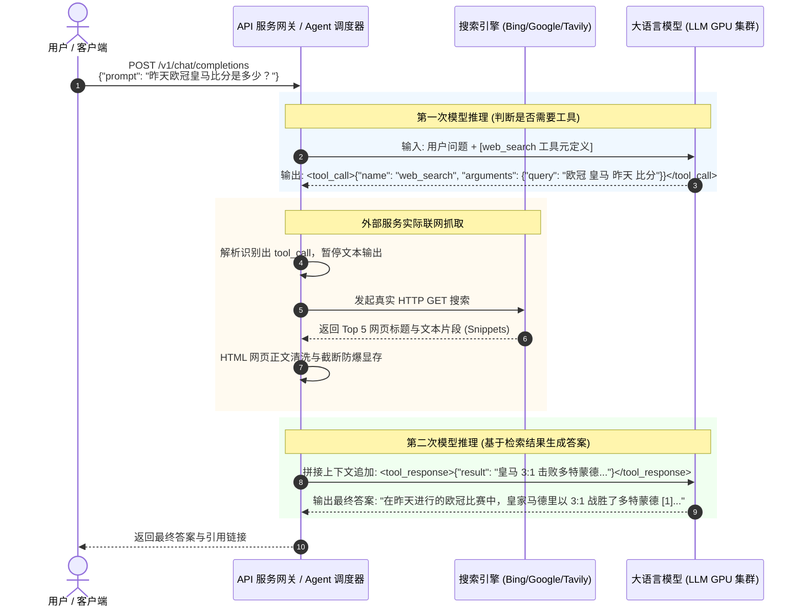

# 深度专题：大模型 API 自带“联网搜索”是如何实现的？从原理到架构全景

> **导读**：在使用 ChatGPT、Kimi、Perplexity 或各种云端模型 API 时，很多同学会看到模型支持“自带联网搜索（Web Search / Search Grounding）”。
> 甚至在 API 参数中只需传一个 `"tools": [{"type": "web_search"}]` 或 `"enable_search": true`，模型就能准确回答昨晚刚发生的足球比分。
> **难道神经网络模型能直接发出 HTTP 请求上网抓网页吗？还是有其他黑科技？**
> 本文结合工业界真实落地方案与 MiniMind-3 源码，深入拆解模型“联网”的底层真相。

---

## 目录
1. [一、灵魂发问：模型真的能自己“上网冲浪”吗？](#一灵魂发问模型真的能自己上网冲浪吗)
2. [二、工业界两套主流落地范式](#二工业界两套主流落地范式)
   * [范式 A：智能体状态机（Agentic Tool Calling）—— 最灵活主流](#范式-a智能体状态机agentic-tool-calling-最灵活主流)
   * [范式 B：前置检索管道（RAG Pipeline / Grounding）—— 最快最稳](#范式-b前置检索管道rag-pipeline--grounding-最快最稳)
3. [三、完整时序拆解：一次带联网搜索调用的真实生命周期](#三完整时序拆解一次带联网搜索调用的真实生命周期)
4. [四、映射到 MiniMind-3：在本地手搓一个带搜索的 Agent](#四映射到-minimind-3在本地手搓一个带搜索的-agent)
5. [五、工业级联网搜索的核心工程挑战与优化技巧](#五工业级联网搜索的核心工程挑战与优化技巧)

---

## 一、灵魂发问：模型真的能自己“上网冲浪”吗？

### ❌ 常见误区：
“大模型内部有网络协议栈，在 `forward()` 生成文本的时候可以暂停，给 Google 发个 socket 包拿网页。”

### ✅ 底层真相：
**大模型（LLM）本身 100% 无法主动访问互联网！**
* 模型的物理本质是：**一堆几百亿个矩阵乘法与浮点数加法的静态参数**。
* 它的运行环境是 GPU 显存，它唯一的输入是 **Token 序列**，唯一的输出也是 **Token 概率分布**。
* 它不知道什么是 TCP/IP，不知道什么是 Chrome，更没有网卡调用权限。

> 💡 **核心结论**：所有的“联网能力”，本质上都是**外层的服务网关（Gateway）/ 运行时框架（Agent Runtime）**，与模型配合演的一场“双簧戏”！

---

## 二、工业界两套主流落地范式

### 范式 A：智能体状态机（Agentic Tool Calling）
这是 OpenAI（GPT-4 Search）、Anthropic（Claude Web）、MiniMind-3 原生 Agent 以及各类 ReAct 框架的标准做法。

* **原理**：将搜索引擎（Google、Bing、Baidu、Tavily、DuckDuckGo）封装成一个标准的**外部函数（Function/Tool）**。
* **模型角色**：模型充当**大脑和决策器**。
  1. 模型分析用户问题，如果觉得需要联网，它就**停止生成普通文本**，而是吐出一段特殊格式的调用指令：
     ```json
     <tool_call>
     {"name": "web_search", "arguments": {"query": "2026年诺贝尔物理学奖得主"}}
     </tool_call>
     ```
  2. 外层网关拦截到这个指令，替模型调用真实搜索 API，抓取网页，清洗成几百字的摘要。
  3. 网关将抓取结果以 `<tool_response>` 塞回上下文，再次唤醒模型：“这是搜索结果，请继续回答”。
  4. 模型根据搜索结果，综合输出最终答案并标注引用来源。
* **优点**：自主性极强。模型可以自主决定“查还是不查”、“分几次查”（例如先查 A，根据结果再查 B）。

---

### 范式 B：前置检索管道（RAG Pipeline / Search Grounding）
这是很多云厂商（如 Google Vertex AI Search Grounding、文心一言部分场景、传统企业 RAG 知识库）的做法。

* **原理**：在模型看到用户的 Prompt **之前**，外层的业务逻辑就先跑去搜索了！
* **模型角色**：模型只充当**阅读理解与总结生成器**。
  1. 用户输入：“今天深圳天气如何？”
  2. 外部网关（Gateway）先跑一个轻量级意图分类器，发现该问题具有强时效性。
  3. 网关背着模型，直接调用 Bing/Google 搜索 `"今天深圳天气"`，截取前 3 条结果。
  4. 网关将 Prompt 偷偷改写成：
     ```text
     【背景参考资料】：
     - 来源1: 深圳今日晴天，气温 20~27℃，微风。
     【用户提问】：
     今天深圳天气如何？请结合上述资料回答。
     ```
  5. 模型收到这段拼装好的长文本，一气呵成生成回答。
* **优点**：时延低（只需 1 次模型推理），控管容易，计费与权限完全由业务方掌握。

---

## 三、完整时序拆解：一次带联网搜索调用的真实生命周期

以最普遍的 **范式 A（Tool Calling 状态机）** 为例，整个交互时序图如下：



---

## 四、映射到 MiniMind-3：在本地手搓一个带搜索的 Agent

在 MiniMind-3 项目中，作者提供了完全原生的工具调用与 Agent 强化学习实现：
* [scripts/eval_toolcall.py](file:///Users/kevin/Code/github/AI/minimind/scripts/eval_toolcall.py)：展示了客户端/网关与模型的闭环交互状态机；
* [trainer/train_agent.py](file:///Users/kevin/Code/github/AI/minimind/trainer/train_agent.py)：展示了如何让模型原生学会生成 `<tool_call>` 标签。

### 1. 观察 MiniMind 的工具调度死循环（State Machine）
打开 `scripts/eval_toolcall.py` 的第 177~200 行：
```python
def run_case(prompt, tools, args, model=None, tokenizer=None, client=None):
    messages = [{"role": "user", "content": prompt}]
    while True:  # 状态机死循环，直到模型不再要求调工具
        # 1. 让模型生成回答
        content = generate(model, tokenizer, messages, tools, args)
        tool_calls = parse_tool_calls(content)
        
        # 2. 如果模型没调工具（或者工具结果已回填完毕，生成了最终答案），结束循环
        if not tool_calls:
            break
            
        messages.append({"role": "assistant", "content": content})
        
        # 3. 外层宿主 Python 代码执行工具逻辑
        for tc in tool_calls:
            name = tc["name"]
            arguments = tc["arguments"]
            print(f'📞 [Tool Calling]: {name} | args={arguments}')
            result = execute_tool(name, arguments)  # 👈 如果接入 web_search，就在这里发 requests.get
            print(f'✅ [Tool Called]: {json.dumps(result, ensure_ascii=False)}')
            
            # 4. 把工具结果塞回对话上下文，喂给模型开启下一轮前向
            messages.append({"role": "tool", "content": json.dumps(result, ensure_ascii=False)})
```

### 2. 如果要给 MiniMind 加上联网搜索，代码只需 3 步：

#### 步骤 1：在 `TOOLS` 列表中注册搜索函数定义
```python
TOOLS.append({
    "type": "function",
    "function": {
        "name": "web_search",
        "description": "通过搜索引擎检索互联网实时信息、最新新闻、事实数据",
        "parameters": {
            "type": "object",
            "properties": {
                "query": {"type": "string", "description": "搜索关键词"}
            },
            "required": ["query"]
        }
    }
})
```

#### 步骤 2：在 `execute_tool` 中接入真实搜索 API（如 DuckDuckGo 或 Tavily）
```python
import requests

def search_internet(query):
    # 可以用免费的 duckduckgo-search 或者各类搜索 API
    resp = requests.get(f"https://api.tavily.com/search?query={query}&api_key=YOUR_KEY")
    snippets = [item["content"] for item in resp.json().get("results", [])[:3]]
    return {"search_results": "\n".join(snippets)}
```

#### 步骤 3：模型微调或者 Few-Shot
只要模型在 SFT 阶段（或 Agent RL 阶段）见过工具调用格式，它就会在面对未知的时效性问题时，自动吐出：
`<tool_call>{"name": "web_search", "arguments": {"query": "..."}}</tool_call>`，由此形成完整闭环！

---

## 五、工业级联网搜索的核心工程挑战与优化技巧

如果你想在生产环境自建一个带联网搜索的 LLM 应用，以下 4 个工程坑点是必须解决的：

| 挑战 | 工业级解决方案 |
| :--- | :--- |
| **1. 网页内容过长撑爆上下文** | 搜索返回的原始 HTML 动辄几十万字。必须先经过 **Readability 算法提取正文** $\to$ **按分块嵌入（Rerank 重排）** $\to$ 仅保留相关度最高的 2000 个 tokens 喂入模型。 |
| **2. 搜索质量与反爬风控** | 商业落地绝不能靠 `BeautifulSoup` 裸爬百度/谷歌（封禁 IP 且很慢）。生产级全部采用专业的 Search-for-AI 接口，如 **Tavily / Exa.ai / Bing Web Search API**，返回纯净结构化 JSON。 |
| **3. 时延过高（首字延迟崩盘）** | 搜索 + 抓取 + 2 次模型推理会导致耗时高达 5~10 秒。业界采用：<br/>① 流式输出中间状态（前端显示“🔍 正在搜索：xxx...”缓解用户焦虑）；<br/>② 投机并行（在模型第一步推理时，提前通过小模型预估搜索词并并发预热请求）。 |
| **4. 虚假引用与幻觉** | 针对模型“看似引用了网页，实际自己瞎编”的现象，在后处理阶段使用专门的 **Grounding Verifier（事实核验模型）** 对答案中的每个标号 `[1]` 进行相似度比对校验。 |

---

> 💡 **总结**：
> * 模型负责“大脑思考”，外层负责“手脚干活”。
> * 所谓 API “自带”联网，只是云服务商把网关、搜索引擎、HTML 解析器和 LLM 组装打包在了一个黑盒接口里，向用户屏蔽了繁琐的中间轮次而已。
