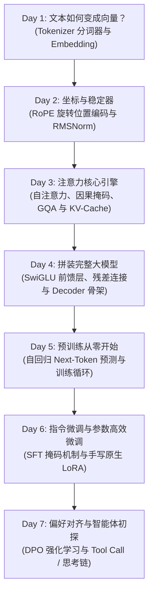

# 📘 MiniMind-3 源码从零进阶实战笔记（从零起步优化版）

> **学习目标**：零基础重新出发！像搭乐高积木一样，从 Tokenizer/Embedding 开始，一步步推导并拼齐 Transformer Decoder，搞懂预训练、SFT 掩码机制，手写 LoRA，并最终理解强化学习与智能体。  
> **时间规划**：2026 年国庆假期（10.01 - 10.07）

---

## 🗺️ 7 天循序渐进全景图（从地基到高楼）

---

## 🗓️ 7 天学习规划与打卡清单

- [ ] **Day 1 (10.01): 语言模型的起点——分词（Tokenizer）与词嵌入（Embedding）**
  - **核心目标**：
    1. 计算机如何理解文字？Byte-level BPE（字节级字节对编码）原理。
    2. MiniMind 为什么选用 6400 极简词表？对参数量和显存的影响。
    3. 特殊 Token 的秘密：`<|im_start|>`, `<|im_end|>`, `<think>`, `<tool_call>` 的作用。
    4. PyTorch `nn.Embedding` 查表机制：Token ID $\to$ 隐藏维度向量。
  - **精读代码**：`model/tokenizer.json`, `trainer/train_tokenizer.py`, `model/model_minimind.py`（Embedding 部分）
  - **笔记与实验目录**：`notes/01_tokenizer_and_embedding/`

- [ ] **Day 2 (10.02): 坐标与稳定器——RoPE 旋转位置编码与 RMSNorm**
  - **核心目标**：
    1. 为什么 Attention 本身是无序的（排列不变性）？必须加入位置信息的直观原因。
    2. 深入 RoPE（旋转位置编码）：为什么通过复数/二维平面旋转就能天然表达相对距离？
    3. 逐行搞懂频率生成：`precompute_freqs_cis` 和旋转应用 `apply_rotary_emb`。
    4. 稳定器 RMSNorm：为什么 LLaMA/Qwen/MiniMind 放弃 LayerNorm 转用 RMSNorm？Pre-Norm 为什么比 Post-Norm 更利于梯度流动？
  - **精读代码**：`model/model_minimind.py`（`RMSNorm`, `precompute_freqs_cis`, `apply_rotary_emb`）
  - **笔记与实验目录**：`notes/02_rope_and_rmsnorm/`

- [ ] **Day 3 (10.03): 核心计算引擎——自注意力（Self-Attention）、GQA 与 KV Cache**
  - **核心目标**：
    1. 从零推导 Attention 经典公式：$\text{Softmax}\left(\frac{Q K^T}{\sqrt{d_k}}\right) V$ 的几何与相似度含义。
    2. 因果掩码（Causal Mask）：为什么解码时必须用下三角矩阵遮盖“未来的词”？
    3. GQA（分组查询注意力）：Q 为 8 个头，KV 为 4 个头，如何通过广播/repeat 节省显存与显存带宽？
    4. 推理加速神器 KV Cache：Prefill（首字）与 Decode（逐字）阶段缓存张量如何拼接更新？为什么能把复杂度从 $O(N^2)$ 压到 $O(N)$？
  - **精读代码**：`model/model_minimind.py`（`Attention` 类与 `repeat_kv` 函数）
  - **笔记与实验目录**：`notes/03_attention_and_kv_cache/`

- [ ] **Day 4 (10.04): 拼装完整 Transformer Decoder 与 MoE 架构**
  - **核心目标**：
    1. 门控前馈网络（SwiGLU）：对比经典 ReLU/GELU FFN，理解门控权重 `w1(x) * silu(w3(x)) * w2` 的非线性表达力。
    2. 梯度高速公路：残差连接 `x = x + sublayer(norm(x))` 是如何避免梯度消失的？
    3. 组装整车：`MiniMindBlock` $\to$ `MiniMindModel` $\to$ `MiniMindLMHeadModel`，输入 ID 到输出 Logits 的全流向。
    4. （选学）MiniMind-3 MoE 扩展：Top-1 门控路由分配与负载均衡辅助 Loss。
  - **精读代码**：`model/model_minimind.py`（`FeedForward`, `MiniMindBlock`, `MiniMindModel`, `MiniMindLMHeadModel`）
  - **笔记与实验目录**：`notes/04_transformer_block_and_moe/`

- [ ] **Day 5 (10.05): 预训练实战（Pretrain）——从零让模型学会接龙**
  - **核心目标**：
    1. 预训练数据究竟长什么样？自回归数据的切分与 Next-Token 构造。
    2. 标签错位位移：`shift_logits = logits[..., :-1, :]` 与 `shift_labels = labels[..., 1:]` 的对齐逻辑。
    3. 训练核心构件：AdamW、学习率预热（Warmup）与余弦退火（Cosine Decay）、梯度裁剪（Clip Grad Norm）。
    4. 动手机器训练：在本地跑一个极小步数的预训练，亲眼见证 Loss 从 8~9 快速下降。
  - **精读代码**：`dataset/lm_dataset.py`（`PretrainDataset`）, `trainer/train_pretrain.py`, `trainer/trainer_utils.py`
  - **笔记与实验目录**：`notes/05_pretrain_flow/`

- [ ] **Day 6 (10.06): 监督微调（SFT）与手写原生 LoRA——让模型听懂人话**
  - **核心目标**：
    1. 预训练（续写）到 SFT（问答）的本质蜕变。
    2. **核心难点：Prompt Loss Masking**：多轮对话中，为什么 PyTorch 的 `CrossEntropyLoss(ignore_index=-100)` 必须把用户 Prompt 置为 `-100`？
    3. 原生手写 LoRA：不依赖 PEFT 库，手动实现低秩矩阵分解 $W + \frac{\alpha}{r}(B \times A)$。
    4. 参数冻结与权重合并：仅训练 1% 不到的参数，微调完如何将增量融合导出。
  - **精读代码**：`dataset/lm_dataset.py`（`SFTDataset`）, `trainer/train_full_sft.py`, `model/model_lora.py`, `trainer/train_lora.py`
  - **笔记与实验目录**：`notes/06_sft_and_lora/`

- [ ] **Day 7 (10.07): 强化学习对齐（DPO）与前沿 Agent / 思考链初探**
  - **核心目标**：
    1. 为什么有了 SFT 还需要偏好对齐？（回答质量、安全与拒绝有害问题）。
    2. DPO（直接偏好优化）极简数学推导：为何不需要独立的 Reward Model 即可完成强化学习？
    3. MiniMind-3 最新亮点全景：`<think>` 思考链标签如何被模型自主生成、Tool Calling 工具调用的协议与回填闭环。
    4. 假期回顾与全景知识树串联，确立后续进阶课题。
  - **精读代码**：`trainer/train_dpo.py`, `scripts/eval_toolcall.py`, `scripts/chat_api.py`
  - **笔记与实验目录**：`notes/07_dpo_and_agent/`

---

## 💡 每天学习建议标准流（2 小时精简高效法）
1. **看原理（30分钟）**：通读当天 README 与核心代码，画一张 Tensor 形状变换图。
2. **跑实验（60分钟）**：在当天子目录下编写/运行 `exp*.py`，打印出中间 Tensor，眼见为实。
3. **记疑问与总结（30分钟）**：在当天的子目录 `README.md` 里记录 1~2 个心得或疑问，随时找我探讨！
